# Discount Guardrails: where deep discounts erode retail profit

**Case study:** [rubaiyat.dev/projects/discount](https://rubaiyat.dev/projects/discount)

---

## Background

Penwick Office Supply sells furniture, office supplies and technology to business and home customers across the US. Between 2014 and 2017 it took **5,009 orders** (9,994 order lines) worth **2.30M** in sales and **286K** in profit. Discounts on those orders ranged from 0% to 80% off.

The Head of Sales sets discount limits once a year and checks them each quarter. Reporting to the Head of Sales, I analysed every order line in SQL Server to answer one question: **what maximum discount should each product group allow?** The insights and recommendations cover five areas:

| Area | Key metrics |
|---|---|
| **Discount depth** | Profit and margin at each of the 12 discount levels; share of sales lost at each level |
| **Product mix** | Margin of each discount band against the same products' full-price margin; margin by product group |
| **Reach** | Customers, orders and products receiving discounts above 20%; how concentrated the loss is |
| **Cap scenarios** *(modelled)* | Profit change under 20–50% caps, for different shares of customers who still buy |
| **Consistency** | Margin by discount band per year, customer segment and region; share of sales above 20% off each quarter |

---

## Executive summary

**Discounts above 20% lost $135K over four years, almost half of what the company made in profit. A 20% cap is the best option tested, but it should be piloted first, because its real risk is losing customers.**

| Sales | Profit | Margin | Orders | Lost on discounts above 20% |
|---:|---:|---:|---:|---:|
| **$2.30M** | **$286K** | **12.5%** | **5,009** | **−$135K** |

- **The line is 20%:** up to 20% off, sales stay profitable (11.9% margin). Every discount level above 20% made a net loss, and above 50% off every single sale lost money.
- **It's the discount, not the products:** the products sold at 30–50% off make 27¢ on every 1 at full price, close to the company average. At those discounts they lost 20¢ on every 1.
- **It's routine:** 71% of customers (565 of 793) got at least one discount above 20%. The loss is concentrated in products: 27 products carry half of it.
- **A 20% cap pays under every assumption *(modelled)*:** re-pricing past orders at a 20% cap adds **+\$135K** to **+\$219K**, and still +$111K if every affected order were lost entirely.
- **Three product groups need a price fix, not a cap:** Tables, Storage and Supplies lose money even at up to 20% off.
- **The habit hasn't gone away:** heavy discounting fell after 2014 but has sat at about 14% of sales since. In the latest quarter, about half of Tables and Machines sales were above 20% off.

---

## Insights deep dive

### Discount depth

**Discounts up to 20% still make money. Every discount above 20% loses it.**

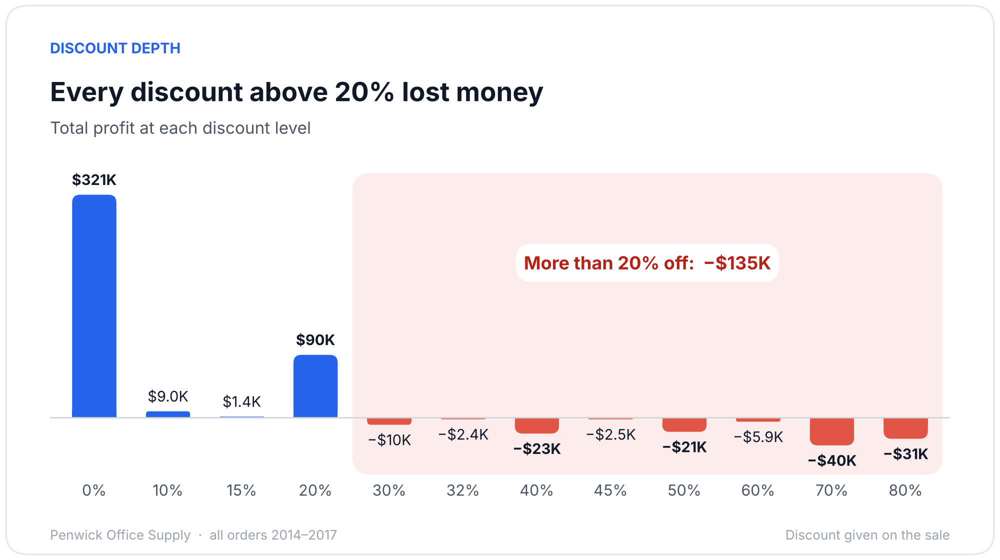
Total profit at each of the 12 discount levels in the data. Discounts of 10–20% made $100.8K together; the eight levels above 20% lost 135.4K.

| Discount | Order lines | Sales | Profit | Margin | Lines at a loss |
|---|---:|---:|---:|---:|---:|
| None | 4,798 | $1.09M | $321.0K | 29.5% | 0% |
| Up to 20% | 3,803 | $846.5K | $100.8K | 11.9% | 14% |
| 30–50% | 537 | $298.5K | −$58.8K | −19.7% | 92% |
| 60–80% | 856 | $64.2K | −$76.6K | −119.2% | 100% |

- **Furniture** is hit hardest: a quarter of its sales (25.1%) went at 30–50% off, at a −24.0% margin.
- **Office Supplies** never used the 30–50% range, but 5.5% of its sales went at 70–80% off, at −119.3%.

### Product mix

**The discount is to blame. The products sold at heavy discounts are normally profitable.**

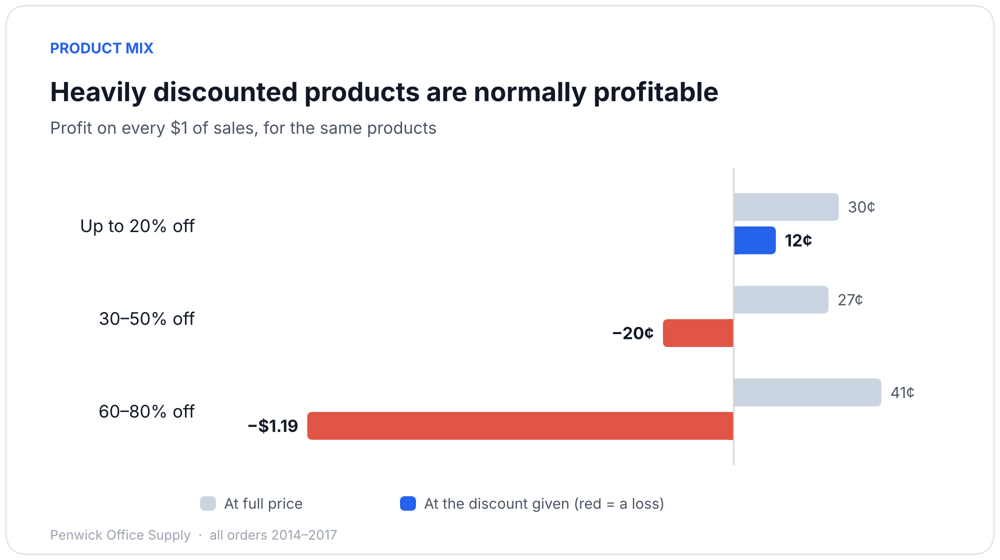
Profit on every $1 of sales, for the same products at full price and at the discount they were sold at.

- The products sold at 30–50% off make **27¢ on every \$1** at full price, close to the company's 30¢. At the discount, they **lost 20¢** on every $1. Product mix explains only 2.9 points of that 49-point drop; the discount explains the other 46.3.
- At 60–80% off, the company lost **\$1.19 for every \$1 it sold**. Most of those sales were Binders, which make 48% at full price.

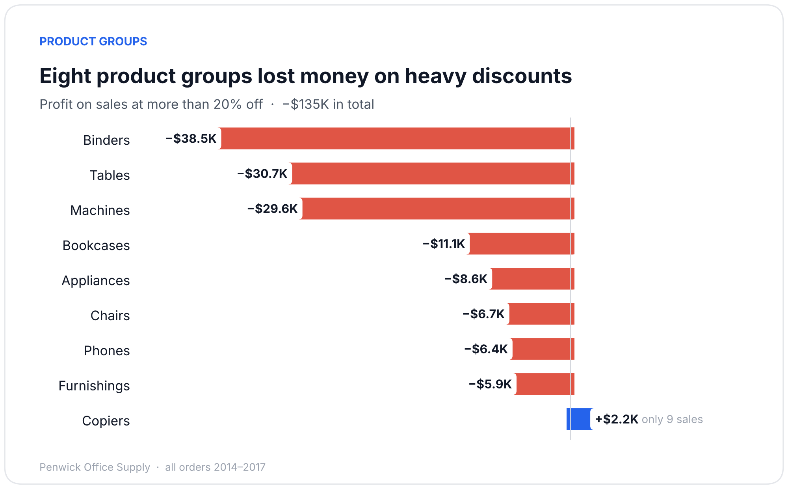
Profit on sales at more than 20% off, by product group. Nine groups were sold at those discounts; eight lost money.

The 17 product groups fall into three camps:

| Camp | Product groups | What the data shows |
|---|---|---|
| **Cap at 20%** (8) | Binders, Tables, Machines, Bookcases, Appliances, Chairs, Phones, Furnishings | Lost money on heavy discounts (chart above) |
| **Review prices** (3) | Tables, Storage, Supplies | Lose money even at up to 20% off (−0.7%, −6.4%, −19.2% margin) |
| **Fine as they are** (7) | Labels, Paper, Envelopes, Copiers, Fasteners, Accessories, Art | Profitable at every discount they were given |

Tables is in two camps: it needs a cap and a price review. Copiers made a small profit above 20% off, but on only 9 sales, which is too few to rely on.

### Reach

**Heavy discounting is normal practice across customers, but the loss sits in a short list of products.**

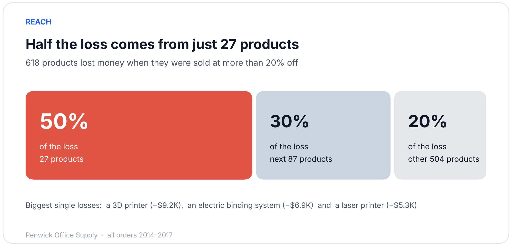
The 618 products that lost money at more than 20% off, ranked from the biggest loss. The first 27 carry half of it.

- 1,393 order lines went at more than 20% off, and **96.8%** of them lost money.
- They reached **565 of 793 customers (71%)**, one in five orders and 649 products. This isn't a handful of rogue deals; it's how the sales team works.
- Binders, Tables and Machines account for 72% of the loss. The biggest single products are 3D printers, electric binding systems, laser printers and conference tables.

### Cap scenarios *(modelled)*

**A 20% cap gives the biggest gain however many customers keep buying.**

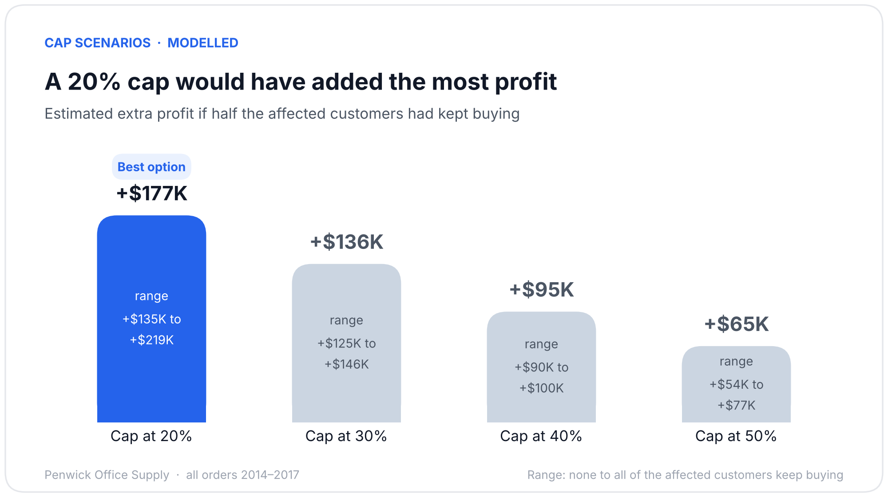
Each sale above the cap is re-priced at the cap, with its cost unchanged. The bar shows the result if half the affected customers kept buying; the range runs from none of them to all of them.

| Cap | Lines capped | No one still buys | Half still buy | All still buy |
|---|---:|---:|---:|---:|
| **20%** | 1,393 | **+$135K** | **+$177K** | **+$219K** |
| 30% | 1,166 | +$125K | +$136K | +$146K |
| 40% | 933 | +$100K | +$95K | +$90K |
| 50% | 856 | +$77K | +$65K | +$54K |

- A 20% cap is also the best cap for each of the eight loss-making product groups on its own.
- **Worse case:** if customers dropped the *whole order* whenever one item was capped, the other items in those 1,020 orders would take \$24.1K of profit with them. The 20% cap would still add **+\$111K**.
- **The real risk is losing customers.** The 565 affected customers made **$300K** on their other purchases, more than the company's total profit. The cap stops paying off if it drives away more than about **45%** of that.

### Consistency

**The pattern held every year and in every region, and heavy discounting has stopped falling.**

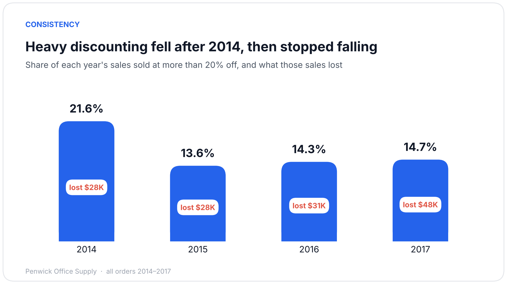
Share of each year's sales sold at more than 20% off, and the profit lost on those sales.

- After a drop in 2015, about **14% of sales** still went at more than 20% off every year, and the loss on them grew to **$48K** in 2017.
- At 30–50% off, the margin was between −16% and −26% in every year, and between −15% (South) and −25% (West) in every region. No customer segment escapes the pattern either.
- **The latest quarter (Oct–Dec 2017):** 52% of Tables sales and 48% of Machines sales were above 20% off, and both groups lost money that quarter.

---

## Recommendations

| Area | Owner | Recommendation | Based on | Expected impact | Effort |
|---|---|---|---|---|---|
| Discount policy | Head of Sales | **Cap discounts at 20%** on the eight "cap" product groups. Anything above needs Sales Manager approval. | Every level above 20% lost money (−$135K); 20% is the best cap in every scenario | **+\$111K to +\$219K** on four years of orders *(modelled)* | Low |
| Pilot | Sales operations + analyst | **Pilot before rolling out:** cap two regions, leave two as they are, for two quarters. Track margin, sales and repeat purchases by the affected customers. Stop if their other profit falls more than 45%. | The gain depends on customers staying, which past data can't show | Turns the modelled range into a measured result | Medium |
| Pricing | Pricing / category manager | **Review list prices and costs** for Tables, Storage and Supplies. | They lose money even at up to 20% off (−0.7%, −6.4%, −19.2%) | Fixes losses a cap can't reach (−$7.5K at up to 20% off) | Medium |
| Products | Category manager | **Check the 27 products** behind half the loss: old stock, mispriced, or discounted to win bigger orders? | 27 of 618 loss-making products carry 50% of the loss | Explains why the heavy discounts happen | Low |
| Monitoring | BI analyst | **Report every quarter** on the share of sales above 20% off and margin by product group, using the quarterly check-up page. | Heavy discounting stuck at ~14% of sales since 2015; Tables and Machines ~50% in the latest quarter | Shows whether the policy is followed | Low |

---

## The dashboard

The Power BI report has four pages written for the sales team, not for analysts. Profit is shown as cents per $1 sold, discount bands have plain names, and every page title states the answer. Year and Region filters on the first two pages carry across the report.

### Overview
**Heavy discounts cost us $135K. What they cost at each size, how common they are, and what to do next.**
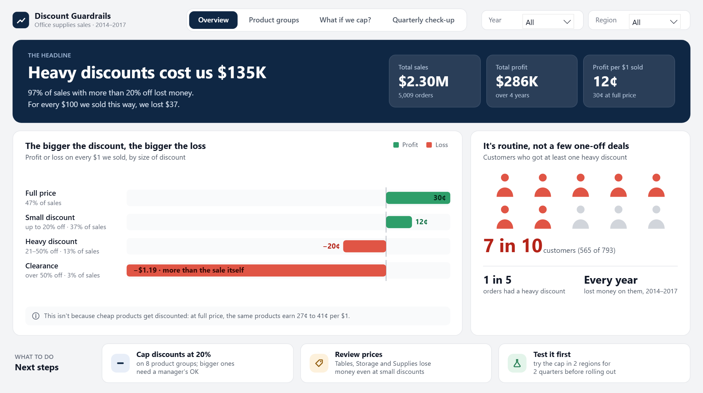

### Product groups
**Our 17 product groups fall into three camps: cap, review prices, or leave alone.**
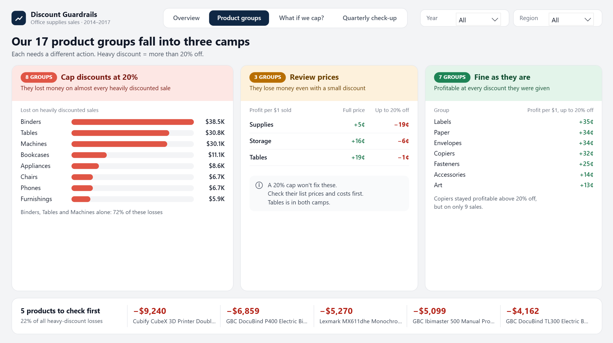

### What if we cap? *(modelled)*
**Choose how many customers still buy, and see what a 20% cap would have done to profit.**
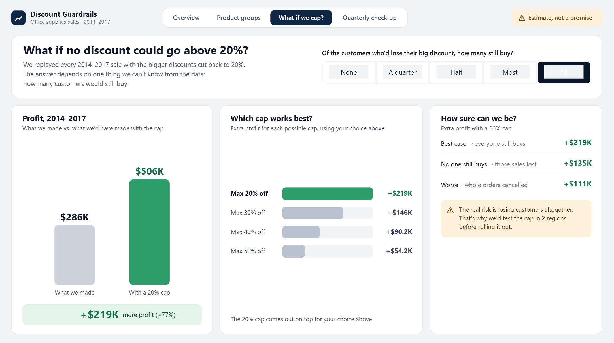

### Quarterly check-up
**Are heavy discounts coming down? The latest quarter against the one before, by product group.**
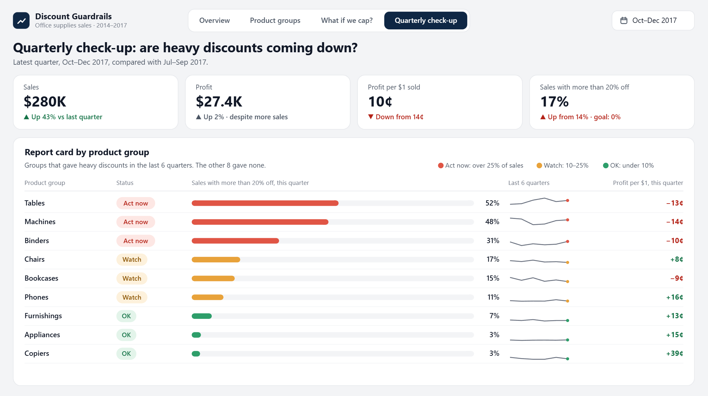

---

## Data structure

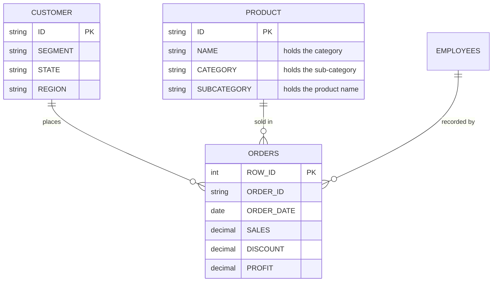

Four tables, one row per order line in ORDERS. Every analysis reads from one SQL view, `fct_order_line`, which joins each line to its product and customer (9,994 rows in, 9,994 out) and adds the discount band, quarter and implied cost (sales − profit). The source PRODUCT columns are mislabelled, so the view renames them. Field definitions are in the [data dictionary](docs/data_dictionary.md).

## Assumptions and caveats

- The data shows what happened, not why a discount was given. If heavy discounts were mostly clearing old stock, they cost less than they look.
- The cap model assumes each sale's cost stays the same when its price changes, and that the share of customers who still buy is the same across product groups.
- Region is the customer's listed location, not the delivery address.
- The sales-rep field was left out: reps look randomly assigned to individual lines, so comparing them would mean nothing.
- The data covers 2014–2017 only, so the latest quarter is Oct–Dec 2017.

## Technical files

- **SQL (SQL Server 2022, T-SQL):** [SQL](sql/) holds the load script, the fact view, one script per area (views, CTEs, window functions), two stored procedures for the cap model and the quarterly check, and 24 validation checks. [Run order](sql/README.md) · [how to run it on a Mac with Docker](docs/run_on_sql_server.md).
- **Validation:** 33 checks, all passing (the 24 SQL checks were run on SQL Server 2022): row counts, keys, joins that add or drop no rows, totals that reconcile to the cent, the edge cases of the cap formula, and a second calculation of the main results in pandas. [What each check does](docs/validation.md).
- **Power BI:** open `powerbi/DiscountGuardrails.pbip` in Power BI Desktop, set the `DataFolder` parameter and click **Refresh**. Power Query, 37 DAX measures and Deneb (Vega) visuals. [Setup and design notes](powerbi/README.md).
- **Report and results:** [full report (PDF)](report/discount_guardrails_report.pdf) · [query results behind every number](results/README.md) · [`scripts/`](scripts/): the Python chart builder and cross-checks.

## About this project

- **Contribution:** by Rubaiyat (Ru) Ruhin. The project extends a SQL Server exercise set I completed on this dataset. I used Claude to speed up drafting and checking. The analysis, the SQL and the recommendations are mine.

---

**Rubaiyat (Ru) Ruhin** · Data Analyst · Master of Data Science, University of Adelaide
[rubaiyat.dev](https://rubaiyat.dev) · [LinkedIn](https://linkedin.com/in/rubaiyatalamruhin) · [GitHub](https://github.com/ruhinb) · rubaiyatalam.ruhin@gmail.com

Penwick Office Supply is a fictional name. The data is a four-table version of the public "Sample – Superstore" retail dataset (US, 2014–2017), and the Head of Sales is a simulated stakeholder.
