# PatientCare — Reducing Missed Appointments

**Case study:** [rubaiyat.dev/projects/patientcare](https://rubaiyat.dev/projects/patientcare)

---

## Background

PatientCare is an outpatient network of **14 clinics** in Bangladesh, with 115 doctors across 12 specialties and **34,460 registered patients**. From January 2022 to mid-June 2023 it booked **73,692 appointments**, about 4,200 a month. About **one in seven** booked patients did not turn up. Each no-show leaves a doctor's slot empty and a fee uncollected, and reporting on attendance took four hours of spreadsheet work every week.

Working with the network's operations team, I consolidated 12 operational data sources (557,423 records) into one reporting model, found where no-shows were concentrated, evaluated a six-week reminder pilot, and built a five-page Power BI report the team can use week to week. The insights and recommendations focus on four areas:

| Area | Key metrics |
|---|---|
| **Attendance and risk** | No-show rate by patient area, month, time of day, booking channel and lead time |
| **Reminder pilot** | No-show rate by reminder group, reduction in percentage points, 95% confidence interval, p-value, delivery rate |
| **Financial impact** | Average visit fee, missed-visit fees, fees kept by the enhanced reminder, 12-month projection |
| **Reporting efficiency** | Weekly reporting minutes before and after automation, minutes by stage, hours saved |

---

## Executive summary

**No-shows concentrate among semi-urban patients, and an enhanced reminder cuts them by a fifth. Rolled out, it would keep about BDT 0.87M a year in fees.**

| Appointments | No-show rate (baseline) | Pilot reduction | Fees kept a year (est.) | Weekly reporting time |
|---:|---:|---:|---:|---:|
| **73,692** | **13.9%** | **−5.9 pts** | **≈ BDT 0.87M** | **244 → 62.5 min** |

13.9% is the pre-pilot baseline: 3,415 no-shows in 24,620 attended or missed appointments from 3 Oct 2022 to 29 Apr 2023. The 14.5% on the Overview dashboard page covers every date from January 2022 to mid-June 2023, including the pilot weeks (9,560 of 65,759).

- **Semi-urban patients are the problem group:** they missed **15.9%** of appointments against **11.9%** for urban patients, in every month and every time slot. They hold about half of the baseline appointments and **56%** of the missed fees.
- **The enhanced reminder works:** a 24-hour message plus a 2-hour follow-up cut their no-show rate from **26.0% to 20.1%** in a six-week pilot (95% confidence interval 1.2 to 10.6 points, **p = 0.013**).
- **No-shows are expensive:** at BDT 1,139 per missed visit, they cost about **BDT 3.9M** in fees over the seven-month baseline. The pilot kept about **BDT 42k** in six weeks.
- **Rollout value:** about **BDT 0.87M a year** if every semi-urban patient gets the enhanced reminder, or BDT 0.44M for the morning slots the pilot tested.
- **Delivery failures matter:** patients whose reminder failed missed **31.8%** of visits, against 19.6% when it arrived.
- **Reporting is three hours faster each week:** automation cut the weekly report from **244 to 62.5 minutes (−74.4%)**. Checking the numbers is now the biggest remaining task.

---

## Insights deep dive

### Attendance and risk

**Semi-urban patients miss a third more appointments, in every month and at every time of day.**

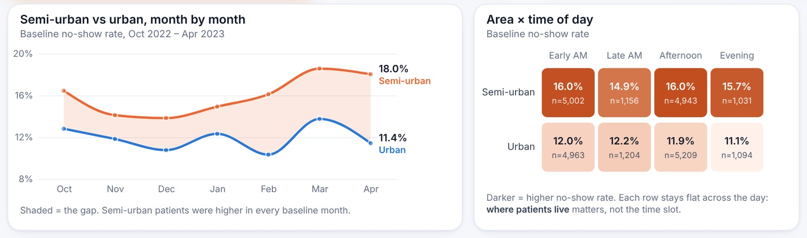
Baseline period, 3 Oct 2022 to 29 Apr 2023 (24,620 attended or missed appointments). The shaded band is the gap; it widened to 18.0% vs 11.4% in April.

- Semi-urban rates stay between **14.9% and 16.0%** from early morning to evening; urban rates between **11.1% and 12.2%**. The gap is about **where patients live, not when they book**, so moving appointment times would not close it.
- Semi-urban patients hold **12,133** of the 24,620 baseline appointments (49%), so improving their rate moves the whole network.

**Walk-ins and same-day bookings are the other hot spots.**

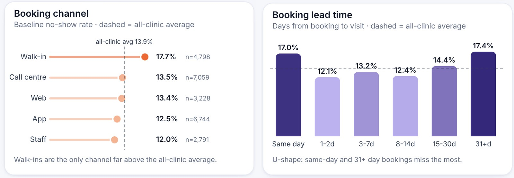
The dashed line is the all-clinic average (13.9%). Walk-ins are the only channel well above it; lead time shows a U-shape.

| Booking channel | No-show rate | Appointments |
|---|---:|---:|
| Walk-in | **17.7%** | 4,798 |
| Call centre | 13.5% | 7,059 |
| Web | 13.4% | 3,228 |
| App | 12.5% | 6,744 |
| Staff | 12.0% | 2,791 |

- **Same-day bookings** miss **17.0%** (5,134 appointments). Bookings 31+ days ahead miss 17.4%, but there are only 184 of them.
- Bookings made 1 to 14 days ahead perform best (12.1% to 13.2%).

### Reminder pilot

**The enhanced reminder cut semi-urban no-shows from 26.0% to 20.1%.**

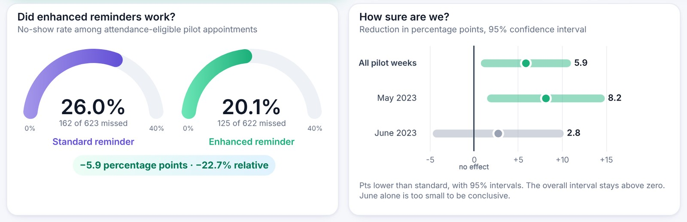
Pilot from 30 Apr to 15 Jun 2023 on semi-urban morning appointments. The interval for all pilot weeks stays above zero.

| Group | Attended or missed | No-shows | No-show rate |
|---|---:|---:|---:|
| Standard reminder | 623 | 162 | 26.0% |
| Enhanced reminder | 622 | 125 | **20.1%** |
| **Difference** | | **37 fewer** | **−5.9 pts (−22.7%)** |

| Period | Reduction | 95% confidence interval | Read as |
|---|---:|---|---|
| All pilot weeks | **5.9 pts** | 1.2 to 10.6 | A real effect (p = 0.013) |
| May 2023 | 8.2 pts | 1.9 to 14.4 | A clear effect |
| June 2023 | 2.8 pts | −4.2 to 9.8 | Too small to call on its own |

- The 1,409 appointments were split **1:1 within each clinic and month**, so the two groups faced the same clinics and months.
- June's weaker result is shown, not hidden: it is why the rollout should keep a comparison group.

**When the reminder fails, the patient is far more likely to miss the visit.**

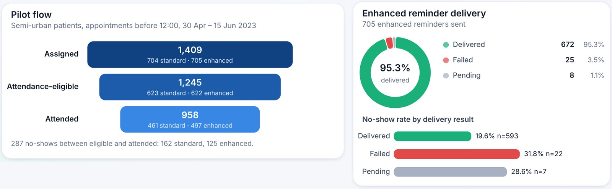
95.3% of the 705 enhanced reminders were delivered. Of the 1,409 assigned appointments, 1,245 ended as attended or missed and 958 were attended.

- Patients whose reminder **failed** missed **31.8%** of visits, against **19.6%** when it was delivered. Only 22 eligible appointments had a failed reminder, so this is a signal to monitor rather than a firm result.

### Financial impact

**No-shows cost about BDT 3.9M in seven months; the enhanced reminder recovers part of it.**

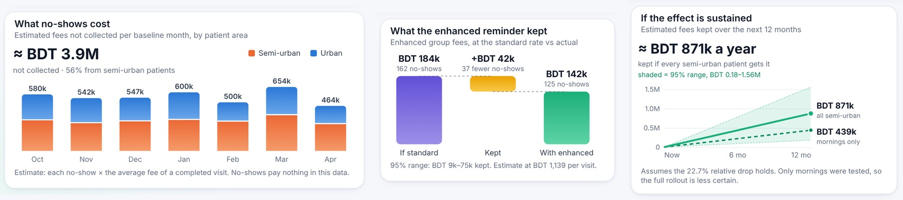
Each no-show is priced at BDT 1,139, the average fee of a completed visit. No-shows have no payment in the data.

| Estimate | Value | 95% range |
|---|---:|---|
| Missed fees, baseline (7 months) | **≈ BDT 3.9M** | n/a (56% from semi-urban patients) |
| Fees kept in the pilot (6 weeks) | ≈ BDT 42k | BDT 9k to 75k |
| Fees kept a year: semi-urban mornings (tested) | ≈ BDT 0.44M | n/a |
| Fees kept a year: all semi-urban patients | **≈ BDT 0.87M** | BDT 0.18M to 1.56M |

- In the pilot, the enhanced group would have missed about **162 visits (≈ BDT 184k)** at the standard group's rate; it missed **125 (≈ BDT 142k)**.
- The yearly projection applies the **22.7% relative** drop to baseline no-shows, not the 5.9 points, because the pilot group started from a higher rate (26.0%) than the baseline (15.9%).

### Reporting efficiency

**Automation saves three hours a week; checking the numbers is now the biggest task.**

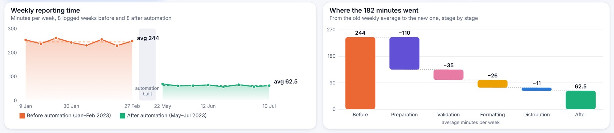
16 logged reporting weeks: eight before automation (Jan–Feb 2023) and eight after (May–Jul 2023).

| Stage | Before (min/week) | After (min/week) | Saved |
|---|---:|---:|---:|
| Preparation | 123 | 13 | **110** |
| Validation | 59 | 24 | 35 |
| Formatting | 41 | 15 | 26 |
| Distribution | 21 | 10 | 11 |
| **Total** | **244** | **62.5** | **182 (−74.4%)** |

- **Preparation** drove the saving (110 of 182 minutes), because the data pipeline now extracts and cleans the data.
- **Validation** is now the largest share (**24 of 62.5 minutes, 38%**): the next place to save time.
- Across the eight automated weeks, the team saved **about 24 hours**.

---

## Recommendations

| Area | Owner | Recommendation | Based on | Expected impact | Effort |
|---|---|---|---|---|---|
| Pilot rollout | Operations / patient communications | **Roll out the enhanced reminder to all semi-urban morning appointments.** | −5.9 pts in the pilot (95% CI 1.2 to 10.6, p = 0.013) | ≈ **BDT 0.44M a year** in fees kept | Low |
| Pilot rollout | Operations | **Extend it to semi-urban afternoon and evening slots** as a second phase. | Those slots run at 15.7% to 16.0%, the same as mornings | Up to ≈ **BDT 0.87M a year** in total | Low |
| Measurement | Analytics | **Keep a small standard-reminder comparison group** in every rollout phase. | June alone was inconclusive (−4.2 to 9.8 pts) | Confirms the effect holds instead of assuming it | Low |
| Delivery | IT / messaging provider | **Review failed reminders monthly** and fix their causes. | Failed reminders: 31.8% no-shows vs 19.6% when delivered; 25 of 705 failed | Protects the pilot's gain | Medium |
| Attendance | Operations / booking team | **Make walk-ins and same-day bookings the next pilot,** for example a same-day confirmation call. | Walk-ins 17.7% and same-day 17.0%, vs the 13.9% average | A second lever beyond patient area | Medium |
| Reporting | Analytics | **Automate the routine validation checks.** | Validation is 24 of 62.5 weekly minutes (38%) | Frees part of the remaining hour each week | Medium |
| Governance | Management | **Re-measure after six months** before rolling out to every clinic. | The pilot ran six weeks; seasonal effects are untested | A safer network-wide decision | Low |

---

## The dashboard

The report has five pages with one header, colour system and layout. Slicers (date, clinic, specialty, consultation mode, patient area) and a **Reset filters** button let the operations team answer follow-up questions without asking an analyst.

### Overview
**73,692 appointments across 14 clinics; 14.5% of attended or missed appointments end as a no-show.**
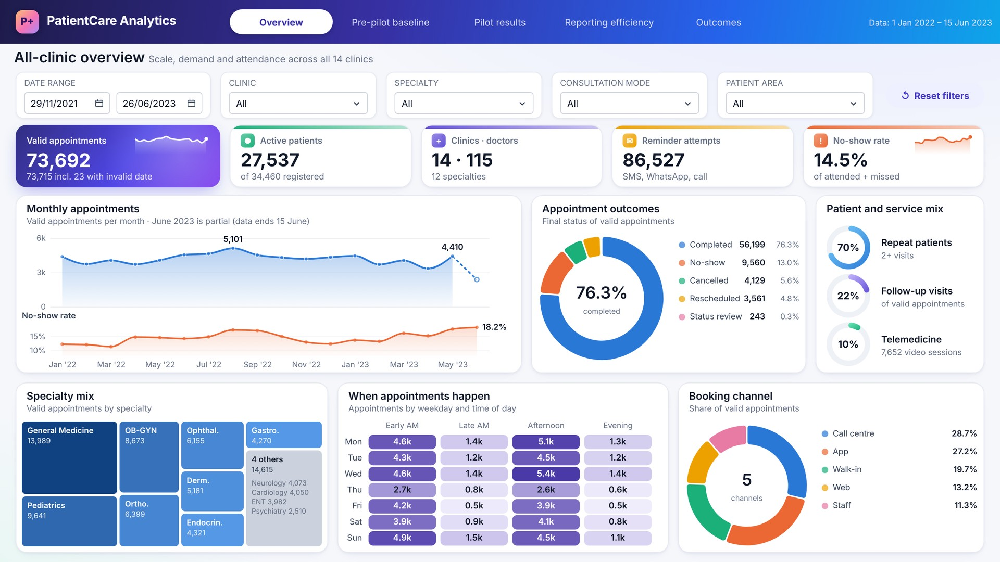

### Pre-pilot baseline
**Semi-urban patients miss 15.9% of appointments against 11.9% for urban patients, costing ≈ BDT 3.9M in seven months.**
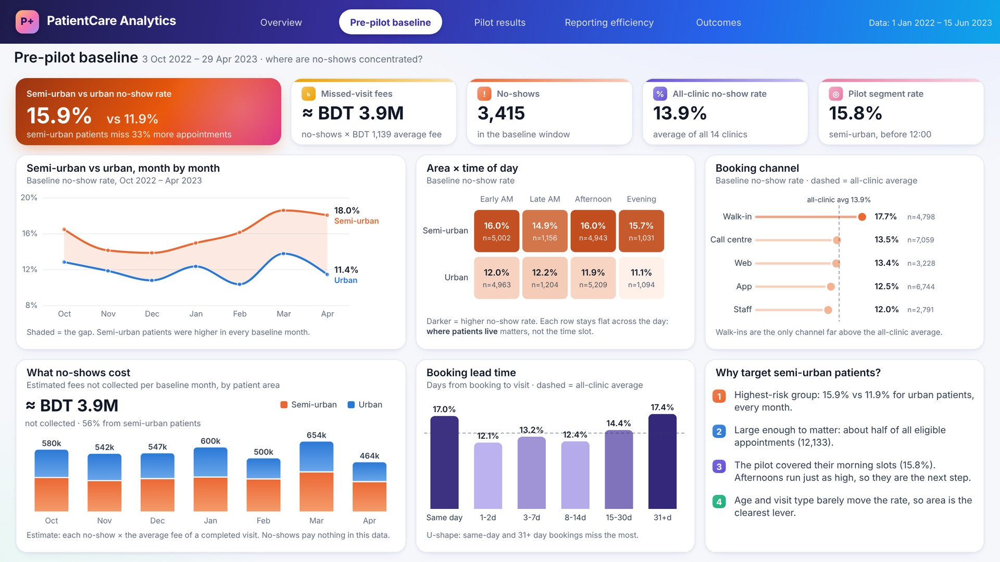

### Pilot results
**The enhanced reminder cut no-shows from 26.0% to 20.1% (p = 0.013) and kept ≈ BDT 42k in six weeks.**
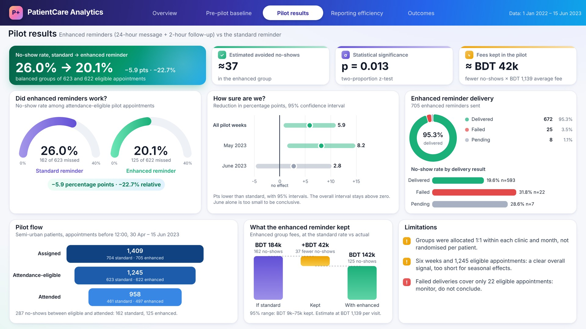

### Reporting efficiency
**Automation cut the weekly report from 244 to 62.5 minutes; preparation drove the saving.**
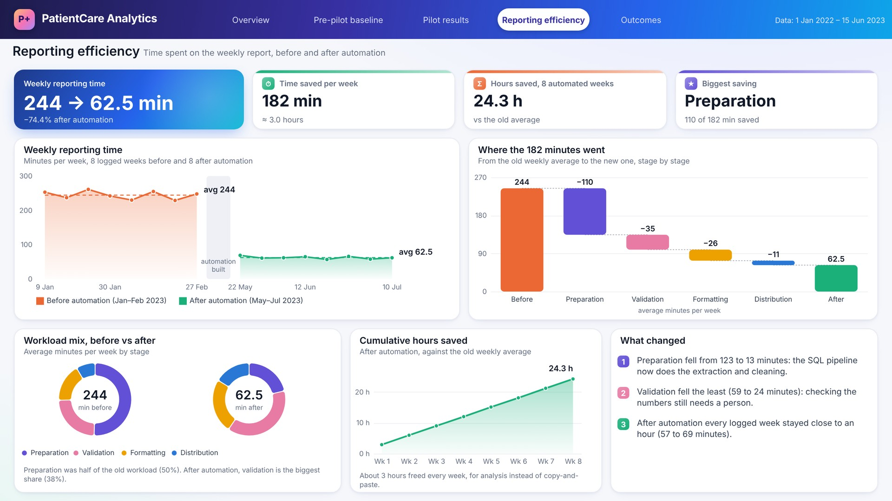

### Outcomes
**−5.9 points on no-shows and −74.4% on reporting time; worth ≈ BDT 0.87M a year if sustained.**
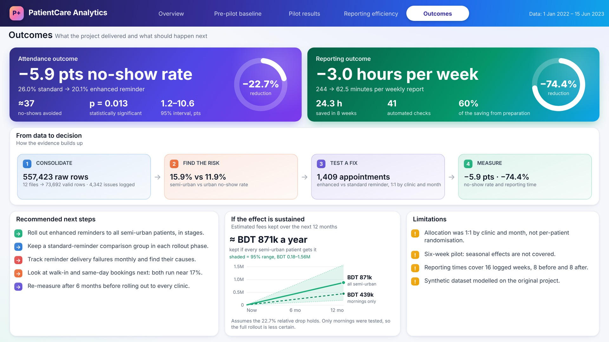

---

## Data structure

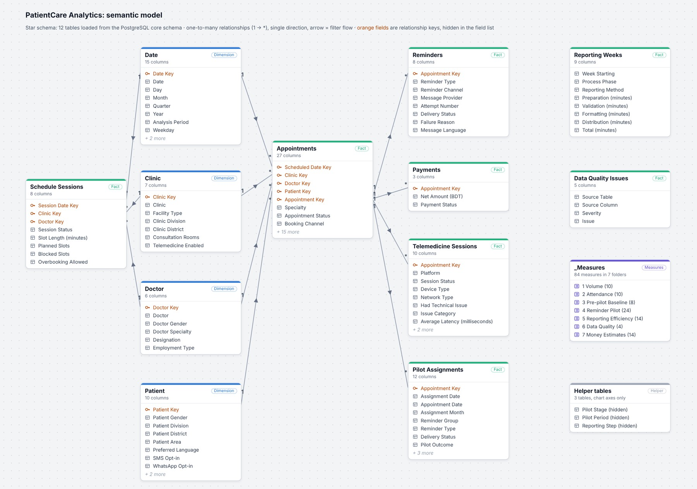

The 12 source extracts (557,423 records) are cleaned in PostgreSQL and loaded into Power BI as a star schema:

- **Four dimensions:** date, patient, clinic and doctor.
- **Eight fact tables:** appointments (at the centre), payments, reminders, telemedicine sessions, schedule sessions, pilot assignments, reporting weeks and data-quality issues.
- **84 DAX measures** in a dedicated measures table, including the pilot's 95% confidence interval and two-proportion z-test.
- **4,342 data-quality issues** logged and kept visible rather than deleted, and **41 automated tests** run before reporting.

Source field definitions are in the [source data dictionary](docs/source_data_dictionary.csv).

## Assumptions and caveats

- Pilot groups were balanced 1:1 within each clinic and month, not randomised patient by patient.
- The pilot ran six weeks on morning slots only, so seasonal effects and afternoon slots are untested.
- Money figures price each no-show at the average fee of a completed visit (BDT 1,139). They exclude the cost of sending reminders and slots that walk-ins refill.
- The yearly projections assume the 22.7% relative reduction holds and baseline volumes stay the same.
- The 23 appointments with an unreadable date are kept in the data but excluded from rates. The raw extract has 24 such rows; one is a duplicate copy or older version of the same appointment, removed during de-duplication.

## Technical files

- **Report:** open `powerbi/PatientCare_Analytics.pbip` in Power BI Desktop, set the **DataFolder** parameter to this repo's `data/sample/processed` folder and refresh. That loads a 500-appointment sample, so the numbers differ from this report. The charts use the free certified Deneb visual, which Desktop downloads on first open.
- **How it was built:** [SQL pipeline guide](sql/README.md), covering the cleaning rules, data-quality log and tests, and [Power BI guide](powerbi/README.md), covering the model, measures, PostgreSQL connection and design rules.
- **Data:** [Data Folder](data/) holds the sample extracts (raw and processed) and explains what is not published.

---

**Rubaiyat (Ru) Ruhin** · Data Analyst · Master of Data Science, University of Adelaide
[rubaiyat.dev](https://rubaiyat.dev) · [LinkedIn](https://linkedin.com/in/rubaiyatalamruhin) · [GitHub](https://github.com/ruhinb) · rubaiyatalam.ruhin@gmail.com

This project is the appointment-reporting and reminder-pilot work from my time as a Data Analyst at Fieldbooster (2022–2023). The original data is confidential, so this repository holds only a sample dataset with the same structure and data-quality problems. See [data/README.md](data/README.md).
