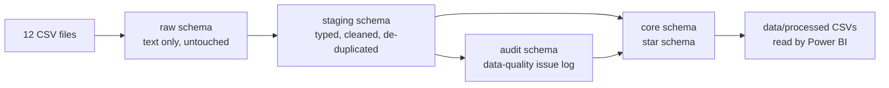

# SQL pipeline

This folder turns 12 raw CSV extracts from the clinic network's systems into a clean star schema that Power BI reads. It runs in PostgreSQL.

**In short:** 557,423 raw rows from 12 files go in. Out come 4 dimension tables and 9 fact tables with no duplicates, one standard label per category, and a log of 4,342 data-quality issues that stay visible in the report instead of being silently deleted.

## How the data moves



| Schema | What it holds | Why it exists |
|---|---|---|
| `raw` | Every CSV column stored as TEXT, plus a row number | Nothing is rejected on load, so bad values can be found and logged later |
| `staging` | Typed, trimmed, standardised and de-duplicated tables | One place where all cleaning rules live |
| `audit` | Data-quality issue log, profiling results, validation results | Every problem can be traced back to its source row |
| `core` | Dimensions and facts with surrogate keys | The reporting model Power BI loads |

## Running it

Requirements: PostgreSQL 12 or later. The scripts use plain SQL only, so they run in any client: VS Code with SQLTools, pgAdmin, DBeaver or `psql`.

**1. Set the project folder path.** Scripts 04 (load) and 18 (export) read and write CSV files with `COPY`, which needs the full path of the project folder. Open each of the two files, use Find and Replace, and replace `/PATH/TO/patientcare-no-show-analytics` with the folder, for example `/Users/yourname/Projects/patientcare-no-show-analytics`.

**2. Run script 01 on the `postgres` database.** It creates the `patientcare_analytics` database. If your client shows "DROP DATABASE cannot run inside a transaction block", run the `DROP` line and the `CREATE` line one at a time.

**3. Switch to the `patientcare_analytics` database and run scripts 02 to 18 in number order.** In VS Code with SQLTools: copy `.vscode/settings.example.json` to `.vscode/settings.json` (it defines both connections; set your PostgreSQL user name), connect to `2 - patientcare_analytics`, open each file and run it (Run on active connection). Each script shows a check result at the end, and script 17 should end with 41 passed and 0 failed.

The whole run writes the reporting CSVs to `data/processed/`. Every script drops and recreates its own tables, so any script can be rerun on its own.

From a terminal, `sql/run_all.sql` does steps 2 and 3 in one go (after step 1):

```bash
psql -d postgres -f sql/run_all.sql
```

## Scripts

| # | Script | What it does |
|---|---|---|
| 01 | `01_setup/01_create_database.sql` | Creates the database |
| 02 | `01_setup/02_create_schemas.sql` | Creates the `raw`, `staging`, `audit` and `core` schemas |
| 03 | `02_raw_load/03_create_raw_tables.sql` | Creates 12 raw tables, all columns TEXT |
| 04 | `02_raw_load/04_load_raw_csv_files.sql` | Loads the CSV files with `COPY` |
| 05 | `03_data_profiling/05_check_raw_row_counts_and_keys.sql` | Checks row counts, unique IDs, duplicates and broken references |
| 06 | `03_data_profiling/06_profile_raw_values.sql` | Lists every category spelling and finds values that will not convert to a date or number |
| 07 | `04_staging/07_create_cleaning_helpers.sql` | Category lookup table (106 spellings to standard labels) and a yes/no to BOOLEAN function |
| 08 | `04_staging/08_clean_master_tables.sql` | Cleans clinics, doctors and patients |
| 09 | `04_staging/09_clean_and_deduplicate_appointments.sql` | Cleans appointments and keeps the latest version of each |
| 10 | `04_staging/10_clean_operational_tables.sql` | Cleans appointment events, doctor schedules and reminders |
| 11 | `04_staging/11_clean_telemedicine_payments_feedback.sql` | Cleans telemedicine sessions, payments (with de-duplication) and feedback |
| 12 | `04_staging/12_clean_pilot_and_reporting_logs.sql` | Cleans the reminder pilot and reporting-process logs |
| 13 | `04_staging/13_log_data_quality_issues.sql` | Runs 20 data-quality checks and logs every issue found |
| 14 | `05_core_model/14_build_dimension_tables.sql` | Builds `dim_date`, `dim_clinic`, `dim_doctor`, `dim_patient` |
| 15 | `05_core_model/15_build_fact_tables.sql` | Builds the 7 operational fact tables and the issue table |
| 16 | `05_core_model/16_build_pilot_and_reporting_facts.sql` | Builds the pilot and reporting-efficiency facts |
| 17 | `06_validation_export/17_validate_core_model.sql` | Runs 41 PASS/FAIL tests on the finished model |
| 18 | `06_validation_export/18_export_core_tables.sql` | Exports the core tables to `data/processed/` |

## What the cleaning fixes

**Duplicate and outdated records.** The appointment extract has 75,291 rows for 73,715 appointments. 266 rows are exact copies of the same record version, and 1,310 are older versions of appointments that were later updated. `ROW_NUMBER()` removes the copies first, then keeps the highest `record_version` for each appointment. Payments get the same treatment (58,354 rows down to 57,261).

**Inconsistent labels.** The same status arrives under many spellings. `Done`, `COMPLETED`, `complete` and `Completed` all mean Completed. `Mobile App`, `mobile_app` and `App` are one booking channel. A lookup table (`staging.category_map`) maps all 106 spellings to 16 sets of standard labels. A new spelling needs one new row in that table, not a code change.

**Yes/no flags.** Booleans arrive as `Yes`, `Y`, `1`, `TRUE`, `no`, `0` and more. `staging.to_yes_no()` turns them into real TRUE/FALSE values.

**Impossible dates.** Profiling every date, time and number column found exactly one bad value: `31/02/2023 09:00` in 24 appointment rows (23 after de-duplication). Those appointments are kept, their date becomes NULL, and they link to the Unknown date row. That is why the model holds 73,715 appointments, of which 73,692 have a valid scheduled date.

**Broken references.** 44 appointments point to a patient who is not in the patient file, 41 to an unknown clinic, and 220 have no doctor recorded. They stay in the model and link to an "Unknown" row (key 0) in each dimension, so totals still reconcile.

## Data-quality log

Script 13 writes every problem to `audit.data_quality_issues` with the source row, column, original value and a description. 4,342 issues were found:

| Table | Issue | Rows | Severity |
|---|---|---:|---|
| Appointment events | Event sequence out of chronological order | 2,015 | Warning |
| Appointments | Specialty not supplied | 449 | Warning |
| Reminders | Marked Delivered but no delivery time | 324 | Error |
| Feedback | Survey answered before it was sent | 315 | Error |
| Appointments | Duplicate extract copy removed | 266 | Warning |
| Appointments | Doctor not recorded | 220 | Warning |
| Patients | Gender not supplied | 174 | Warning |
| Payments | Duplicate extract copy removed | 136 | Warning |
| Payments | Net amount is not gross minus discount | 91 | Error |
| Reminders | Read time but no delivery time | 70 | Warning |
| Payments | Negative amount | 64 | Error |
| Appointments | Parent appointment does not exist | 51 | Warning |
| Appointments | Patient not found | 44 | Error |
| Appointments | Clinic not found | 41 | Error |
| Telemedicine | Session status disagrees with appointment status | 27 | Error |
| Appointments | Scheduled start is not a real date | 23 | Error |
| Feedback | Overall rating outside 1 to 5 | 16 | Error |
| Feedback | NPS score outside 0 to 10 | 14 | Error |
| Appointments | Booked after the scheduled start | 2 | Error |

A 20th check (consultation started before check-in) found no issues in this extract and stays in place for future loads.

Every fact and dimension row also carries `data_quality_issue_count` and `has_data_quality_issue`, so the report can filter or flag affected records.

## Core model

| Table | Grain | Rows |
|---|---|---:|
| `dim_date` | One calendar day (plus Unknown) | 576 |
| `dim_clinic` | One clinic (plus Unknown) | 15 |
| `dim_doctor` | One doctor (plus Unknown) | 116 |
| `dim_patient` | One patient (plus Unknown) | 34,461 |
| `fact_appointments` | One appointment, latest version | 73,715 |
| `fact_appointment_events` | One status change | 257,288 |
| `fact_schedule_sessions` | One planned doctor session | 17,788 |
| `fact_reminders` | One reminder attempt | 86,527 |
| `fact_telemedicine_sessions` | One video consultation | 7,652 |
| `fact_payments` | One payment, latest version | 57,261 |
| `fact_feedback` | One patient survey | 18,509 |
| `fact_reminder_pilot_assignment` | One appointment in the reminder pilot | 1,409 |
| `fact_reporting_process_log` | One reporting week | 16 |
| `data_quality_issues` | One logged issue | 4,342 |

`fact_appointments` also carries the analysis columns the report slices by: booking lead time and band, time-of-day band, patient age and age band, the pilot target segment and the reminder delivery outcome. Each band has a matching `_sort` column so Power BI shows them in the right order. These were DAX calculated columns in an earlier version of the model. Computing them once in SQL makes the Power BI file smaller and faster to refresh.

**Pilot target segment.** `pilot_target_segment` marks appointments for semi-urban patients scheduled before 12:00. Semi-urban patients are the high no-show group (15.9% vs 11.9% for urban patients in the pre-pilot baseline), and the pilot ran on their morning appointments. Validation test "pilot rows outside the target segment" confirms all 1,409 pilot appointments fit this definition.

**Analysis periods.** `dim_date.project_analysis_period` follows the project timeline:

| Period | Dates |
|---|---|
| Pre-project history | 1 Jan 2022 to 2 Oct 2022 |
| Pre-pilot baseline | 3 Oct 2022 to 29 Apr 2023 |
| Pilot | 30 Apr 2023 to 15 Jun 2023 (final data cut-off) |

## Design decisions

- **Keep bad rows, log them.** Deleting the 23 appointments with an impossible date or the 44 with an unknown patient would make totals disagree with the source system. Linking them to an Unknown member keeps every count reconcilable.
- **SQL cleans, Power BI analyses.** No KPIs, rates or findings are calculated in SQL. The pipeline only prepares trustworthy tables. All measures live in the Power BI model.
- **Rebuild, don't patch.** Every script drops and recreates its tables, so the whole pipeline can be rerun safely at any time.
- **Validate before export.** Script 17 runs 41 tests (row counts, unique keys, relationships, pilot segment, Unknown members, unmapped categories, calendar gaps). All 41 pass on the full data. The results are exported to `data/processed/validation_results.csv`.

## Running on the sample data

`data/sample/raw/` holds a small extract (about 500 appointments and their related rows) in the same format as `data/raw/`. Copy the sample files into `data/raw/` and run `run_all.sql` to try the pipeline end to end. On the sample, script 17 shows 26 passed and 15 failed: the 15 are row-count tests whose expected values are for the full dataset. Every other step runs the same way.

The result of that run is already in `data/sample/processed/`, so Power BI can load the sample without running SQL.
