# Slice & Co. — Pizza Operations Analytics

**Case study:** [rubaiyat.dev/projects/slice](https://rubaiyat.dev/projects/slice)

---

## Background

Slice & Co. is a single-site pizza kitchen that sells 32 pizzas across four categories and five sizes. In 2015 it took **21,350 orders** worth **$817.9K**. The General Manager could see the takings each day but had no view of *when* the money came in, *which* pizzas earned it, *why* some days were very different, or whether staff were rostered at the right times.

Reporting to the General Manager, I analysed every 2015 order (48,620 order lines) and built a five-page Power BI report the manager can use week to week. The insights and recommendations focus on four areas:

| Area | Key metrics |
|---|---|
| **Sales and demand** | Revenue, orders, average order value, orders per trading day, orders by hour and weekday |
| **Menu and basket** | Revenue and pizzas sold by pizza, category and size; average selling price; single-pizza order share |
| **Unusual trading days** | Daily revenue and orders vs. a typical same weekday; what drove each change |
| **Labour efficiency** | Labour cost, labour cost as % of revenue, staff on shift vs. staff needed per half-hour |

---

## Executive summary

**Sales were flat in 2015, so growth has to come from serving peaks better, selling bigger baskets and spending labour where the customers are.**

| Revenue | Orders | Pizzas sold | Avg order value | Pizzas per order |
|---:|---:|---:|---:|---:|
| **$817.9K** | **21,350** | **49,574** | **$38.31** | **2.32** |

- **Flat year:** monthly revenue stayed between \$64.0K and \$72.6K. The second half was 2.3% below the first, driven by fewer orders (−2.2%), not smaller ones.
- **Two rushes make the day:** 56% of revenue arrives in about five hours, at lunch (12:00–1:30 PM, 21%) and dinner (4:30–8:00 PM, 35%). Friday is the busiest day.
- **The basket is the biggest lever:** 38% of orders are a single pizza (\$16.52, against \$51.66 for multi-pizza orders). Converting 1 in 10 of them is worth about **\$13K a year**.
- **Chicken leads the menu:** three chicken pizzas bring in 15.6% of revenue. Brie Carre sold only 490 all year at $23.65, dearer than any Large on the menu.
- **Unusual days are predictable:** the biggest spikes fall on Independence Day, Thanksgiving, Black Friday and Super Bowl Sunday (+65% to +89%), worth about $11K above normal.
- **Labour sits in the wrong hours:** 3–6 PM holds 36% of rostered hours but only 27% of orders. A demand-based roster would cut labour from **38.0% to 33.1% of revenue** (about $39.6K a year).

---

## Insights deep dive

### Sales and demand

**Sales held steady all year; the second half lost orders, not order value.**

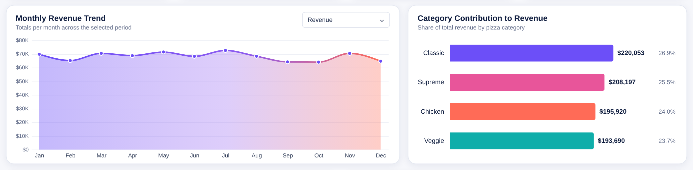
Revenue ranged from $64.0K (October) to \$72.6K (July). Classic pizzas earned the most (\$220.1K, 26.9%); the other three categories were within \$15K of each other.

- H2 revenue was **2.3% below H1**. Orders fell 2.2% while the average order value barely moved (−0.1%), so the gap is about winning orders, not pricing.
- No month stands out as a peak season. The business is stable, so growth will not come from waiting for a busy period.

**Over half the day's revenue arrives in two rushes, and Friday is the busiest day.**

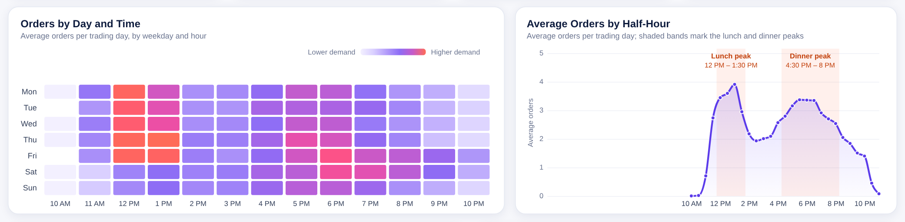
Lunch (12:00–1:30 PM) brings in 21% of revenue in 90 minutes; dinner (4:30–8:00 PM) brings in 35%.

- Lunch is short and sharp, peaking at about **7 orders an hour** on an average day. Dinner is longer and flatter.
- **Friday** averages **70.8 orders** per trading day; **Sunday** is the quietest at **50.5**.
- A new order arrives **every 11 minutes** on average, so any prep left until the rush starts slows every order behind it.

### Menu and basket

**Chicken pizzas earn the most per sale; Classic pizzas sell the most.**

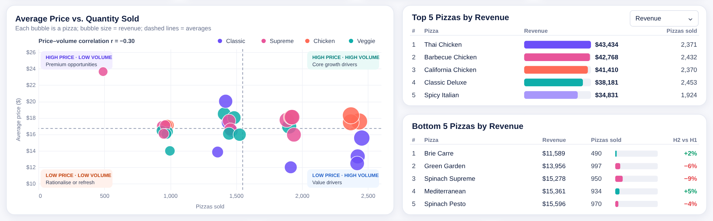
Each bubble is a pizza. The chicken trio sits in the high-price, high-volume corner; Brie Carre sits alone in the high-price, low-volume corner.

| Category | Revenue | Share | Pizzas sold | Avg price |
|---|---:|---:|---:|---:|
| Classic | $220.1K | 26.9% | 14,888 | $14.78 |
| Supreme | $208.2K | 25.5% | 11,987 | $17.37 |
| Chicken | $195.9K | 24.0% | 11,050 | $17.73 |
| Veggie | $193.7K | 23.7% | 11,649 | $16.63 |

- **Thai, Barbecue and California Chicken** are the top three by revenue, together **15.6% of all revenue**. Classic Deluxe sells the most (2,453).
- **Brie Carre** is the weakest item: 490 sold. It comes only as a Small yet costs **\$23.65**, more than any Large (the dearest is \$21.00) and almost double the next-priciest Small (\$12.75).
- **Sizes:** Large is 38% of pizzas sold. Classic is the only category where customers prefer Small. XL and XXL together are about 1% of sales, and only one pizza offers them.
- Cheaper pizzas sell slightly more, but the link is weak (correlation −0.31). Price is not what drives a pizza's popularity.
- **Garlic** is in the most pizzas sold (27,913), then tomatoes and red onions. These drive ingredient purchasing.

**More than a third of orders are a single pizza.**

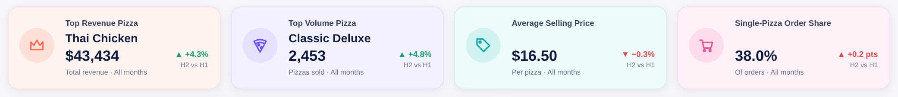
38.0% of orders (8,111) contain one pizza. They average \$16.52, against \$51.66 for multi-pizza orders.

- If **1 in 10** single-pizza orders added a second pizza, revenue would rise by about **$13.4K a year (+1.6%)** with no new customers.

### Unusual trading days

**The year's biggest spikes and drops line up with the calendar, so they can be planned for.**

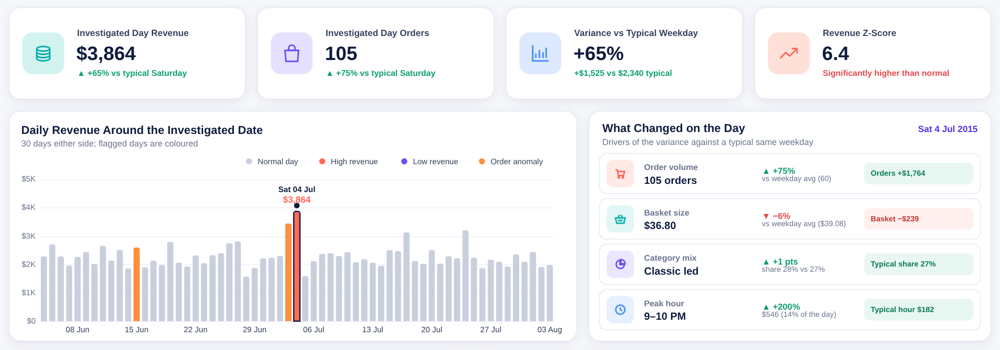
On 4 July, revenue was 65% above a typical Saturday. Orders rose 75% while spend per order fell 6%, and the busiest hour was 9–10 PM, three times its usual level.

Each day is compared with other days of the same weekday (Fridays with Fridays). Days far outside the normal range are flagged; there were **21** in 2015: 9 spike days, 8 low days and 4 days with unusually many orders but normal revenue.

| Date | What happened | vs. a typical same weekday | Likely reason |
|---|---|---:|---|
| Sat 4 Jul | Revenue spike | **+65%** | Independence Day (evening fireworks) |
| Thu 26 Nov | Revenue spike | **+89%** | Thanksgiving |
| Fri 27 Nov | Revenue spike | +65% | Black Friday |
| Sun 1 Feb | Revenue spike | +69% | Super Bowl Sunday |
| Thu 15 Oct | Revenue spike | +85% | No public event; ask the store team |
| 26–30 Dec | Revenue drop | down to −40% | Week after Christmas |

- The **9 spike days** earned about **\$11.4K more** than normal days would have; the **8 low days** cost about **\$5.4K**.
- The spikes come from **more customers**, not bigger orders, so they call for extra staff and stock rather than discounts.

### Labour efficiency

**Rostered hours peak in the afternoon lull, not when customers order.**

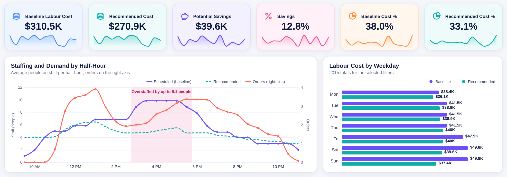
From 3 to 6 PM the roster carries 4–5 more people than demand needs, while lunch is close to the right level.

- **3–6 PM** holds **36% of rostered hours** but only **27% of orders**.
- A roster sized to orders and pizzas in each half-hour would cost **\$270.9K instead of \$310.5K**: a **12.8% saving ($39.6K)**, taking labour from **38.0% to 33.1% of revenue**.
- **Sunday** offers the biggest saving (**$12.5K**): it gets the heavy weekend roster on the quietest day of the week.

## Workforce scenario

- **Baseline:** fixed shifts of about 8 hours with a 30-minute unpaid break: Monday–Thursday 2 managers, 3 cooks, 3 service crew, 1 prep; Friday–Sunday add one cook and one server (12:00–8:00 PM). Paid hours and cost are spread evenly over the half-hours each shift covers. Wages use BLS May 2015 national mean wages.
- **Gap** = scheduled − recommended people (positive = overstaffed).

---

## Recommendations

| Area | Owner | Recommendation | Based on | Expected impact | Effort |
|---|---|---|---|---|---|
| Demand | Kitchen lead | **Finish prep before 11:30 AM and 4:30 PM**, and put the strongest team on Friday lunch and Friday 5–7 PM. | 56% of revenue arrives in two rush windows; Friday averages 70.8 orders a day | Faster service and fewer lost orders at peak | Low |
| Basket | Marketing / front counter | **Offer a second pizza or a side** at the till and online with every single-pizza order. | 38% of orders are one pizza (\$16.52 vs. \$51.66 for multi-pizza orders) | ≈ **+$13K a year** if 1 in 10 converts | Low |
| Menu | General Manager / menu | **Give the chicken trio and Classic Deluxe the best menu spots**, and build bundles around them. | Chicken trio = 15.6% of revenue; Classic Deluxe is the top seller | Protects the highest-earning items and supports the basket offer | Low |
| Menu | General Manager / menu | **Reprice or resize Brie Carre**, and review the XL/XXL sizes. | 490 sold at $23.65 (Small only); XL/XXL ≈ 1% of pizzas | Simpler menu and less waste | Medium |
| Trading days | General Manager | **Plan a trading calendar:** extra dough and evening staff for Independence Day, Super Bowl Sunday, Thanksgiving week and Black Friday; a lean roster from 26 to 30 December. | Holiday spikes +65% to +89%; the post-Christmas week down by up to 40% | Captures ≈ $11K of peak demand and avoids idle staff | Low |
| Labour | Roster manager | **Stagger afternoon shift starts and give Sunday a lighter roster.** Per half-hour, 1 manager; cooks = max(1, ⌈pizzas × 1.15 ÷ 5⌉); service = max(1, ⌈orders × 1.15 ÷ 4⌉); 1 prep from 9:30 AM until 5:30 PM. Cost = 0.5 h × hourly rate per person. Trial for 4 weeks while tracking order times and customer feedback. | 3–6 PM = 36% of hours but 27% of orders; Sunday saving $12.5K | Up to **12.8% lower labour cost** (≈ $39.6K a year), to be confirmed with actual payroll | Medium |

Every figure behind these points is in **[docs/findings.md](docs/findings.md)**.

---

## The dashboard

The report has five pages with one sidebar, colour system and layout, built from approved design mockups. Filters (month, category, size, day type, weekday, demand band), a **Reset filters** button and auto-written insight panels let the manager answer follow-up questions without asking an analyst.

### Executive Overview
**Revenue was flat, Friday drives volume, and the basket is the biggest lever.**
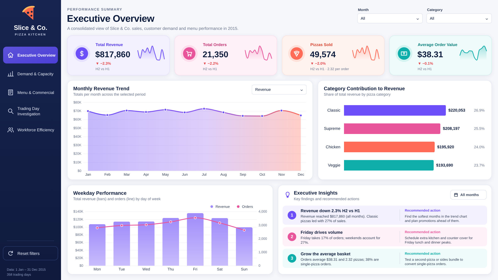

### Demand & Capacity
**Lunch and dinner bring in over half of revenue; the kitchen must be ready before 12 PM and 4:30 PM.**
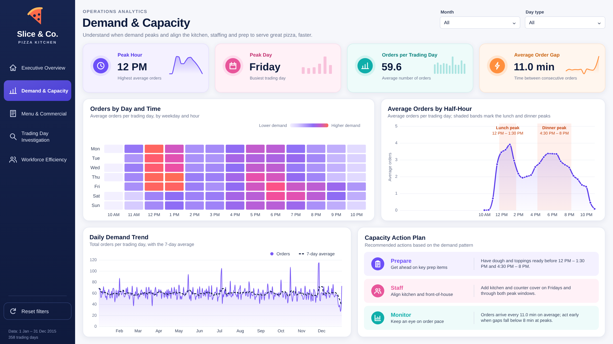

### Menu & Commercial Priorities
**Back the chicken range and Classic Deluxe; fix Brie Carre; sell a second pizza.**
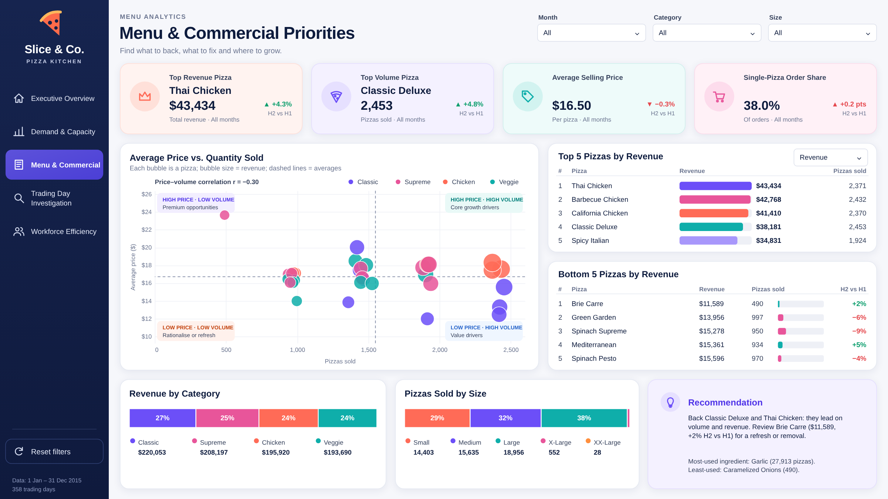

### Trading Day Investigation
**Pick any day to see how it compared with a typical same weekday, what drove the difference and what to check next.**
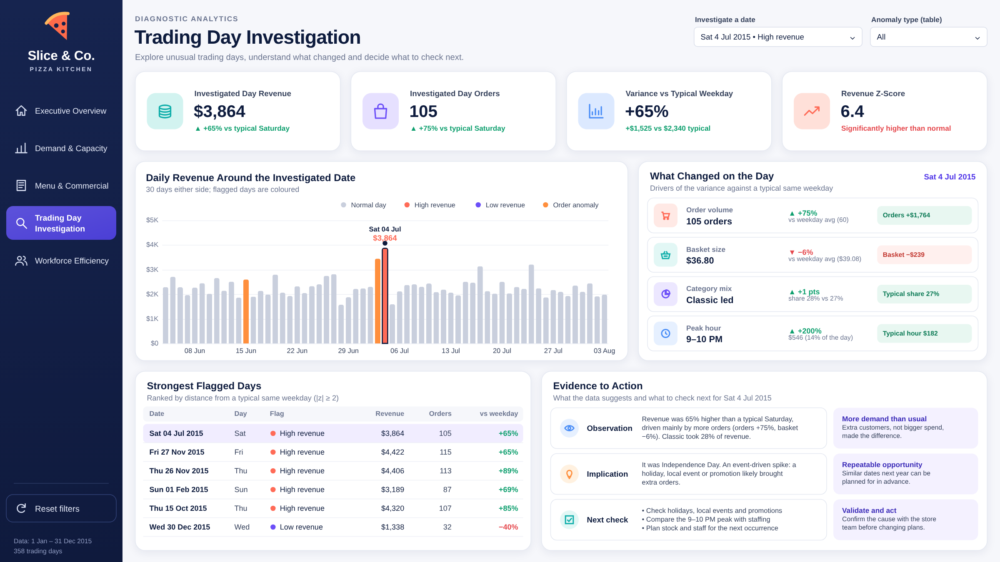

### Workforce Efficiency
**The afternoon roster carries the most surplus labour; a demand-based roster saves 12.8%.**
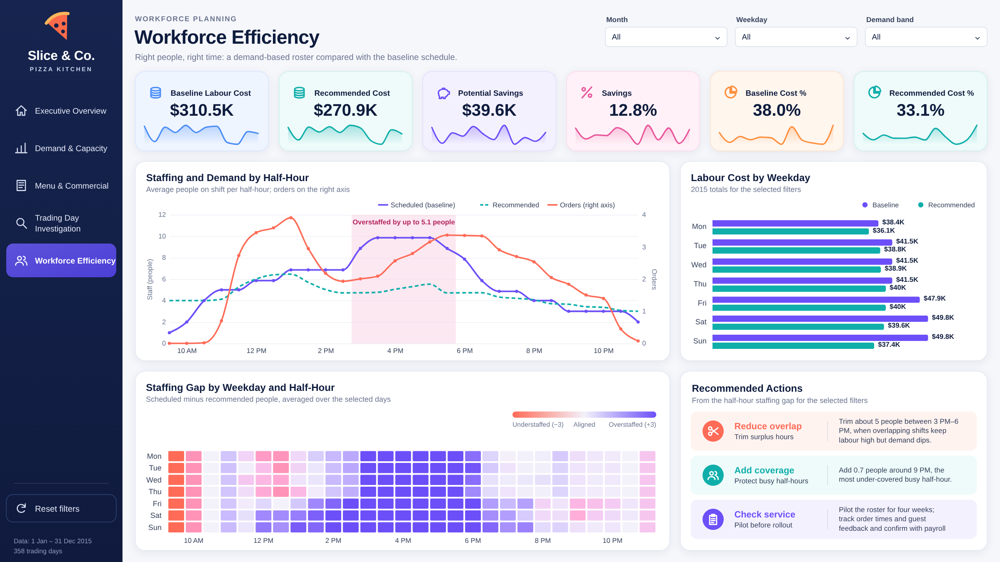

---

## Data structure

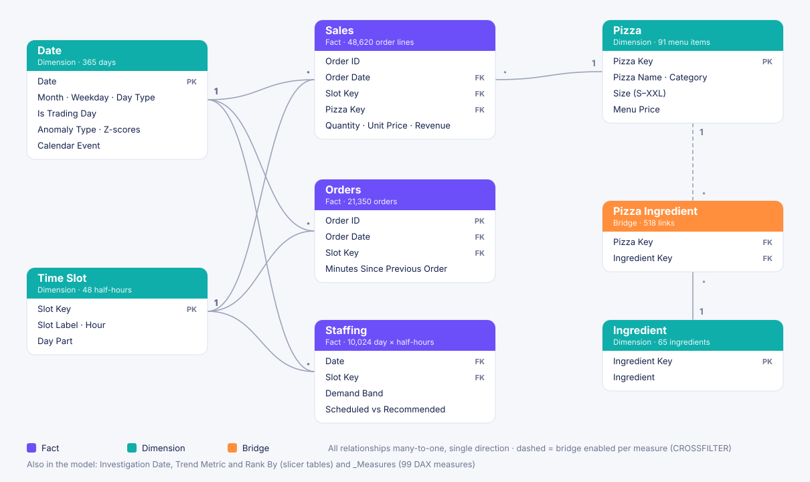

The sales data is one flat file of 48,620 order lines. In Power BI it is reshaped into a star schema:

- **Three fact tables:** order lines, orders, and staffing by half-hour.
- **Five lookup tables:** date, time slot, pizza, ingredient and the pizza-to-ingredient link.
- **99 DAX measures** in a dedicated measures table.

Field definitions are in the [Data dictionary](docs/data_dictionary.md).

## Assumptions and caveats

- One year of data (2015), so comparisons are within the year: previous month, or second half vs. first half.
- Holiday context comes from the 2015 U.S. calendar.
- Impact estimates assume customer behaviour stays as in 2015. The basket estimate assumes each converted order adds one pizza at the average price ($16.50).
- The workforce recommendation does not account for breaks, travel, minimum shift lengths, delivery drivers or service-time targets. It is a sizing signal, not a roster.

## Technical files

- **Report:** open `powerbi/Slice and Co Pizza Analytics.pbip` in Power BI Desktop and click **Refresh**. The data is built into the model. The charts use the free certified Deneb visual, which Desktop downloads on first open.
- **Reference:** [Measure catalogue](docs/measure_catalogue.md) (every DAX measure) · [Data dictionary](docs/data_dictionary.md) · [Full findings](docs/findings.md)
- **Data:** [Data](data/) holds the 2015 sales file as supplied, its data dictionary and the staffing roster.

---

**Rubaiyat (Ru) Ruhin** · Data Analyst · Master of Data Science, University of Adelaide
[rubaiyat.dev](https://rubaiyat.dev) · [LinkedIn](https://linkedin.com/in/rubaiyatalamruhin) · [GitHub](https://github.com/ruhinb) · rubaiyatalam.ruhin@gmail.com

Slice & Co. is a sample business. The 2015 sales data was supplied with the project brief and remains the property of its original provider. Released under the [MIT License](LICENSE).
